<p align="center">
  <picture>
    <source media="(prefers-reduced-motion: reduce) and (prefers-color-scheme: dark)" srcset="assets/banner-dark-still.svg">
    <source media="(prefers-reduced-motion: reduce)" srcset="assets/banner-light-still.svg">
    <source media="(prefers-color-scheme: dark)" srcset="assets/banner-dark.svg">
    
  </picture>
</p>

<p align="center">
  
  <a href="LICENSE"></a>
</p>

<p align="center">Every 5 minutes it works out how high the sun is where you are and sets the screen brightness from that. No light sensor, no app, no account.</p>

<br>

## A day on your screen

The shortest and the longest day of the year in Vienna, macOS defaults, built-in display:

```
  %
  70 ┤       ░░░░░░░░░░░░
  65 ┤      ░░░█████░░░░░░
  60 ┤      ░░░██████░░░░░
  55 ┤     ░░░████████░░░░░
  50 ┤     ░░█████████░░░░░
  45 ┤    ░░░██████████░░░░░
  40 ┤████████████████████████
     └┬─────┬─────┬─────┬─────┐
      00    06    12    18    24

      █ 21 Dec, sun 07:42 to 16:03
      ░ 21 Jun, sun 04:54 to 20:59
```

There is no schedule to set. On 21 December the screen leaves its night level at 06:35 and is back there by 17:15, and it never reaches full brightness. On 21 June it holds full brightness from 07:40 to 18:15 and settles at night level only at 22:35.

## Why the sun and not the clock

A clock schedule is right twice a year. The sun is right every day. Vienna at 17:00, macOS defaults:

| Date | Sun | Outside | Built-in | External |
|---|---:|---|---:|---:|
| 21 June | 36.4° | full daylight | 70 | 45 |
| 20 March | 10.1° | low afternoon sun | 59 | 32 |
| 21 December | −9.1° | dark for an hour already | 40 | 7 |

Daylight saving time, time zones and travel do not matter: the math runs in UTC and the location updates itself.

## Install

**macOS**

```bash
git clone https://github.com/nkovalcin/solar-brightness.git
zsh solar-brightness/macos/install.sh
```

**Windows** (PowerShell, no administrator rights)

```powershell
git clone https://github.com/nkovalcin/solar-brightness.git
powershell -ExecutionPolicy Bypass -File solar-brightness\windows\install.ps1
```

The installer prints where it thinks you are and today's curve, then sets the brightness once. From then on it runs in the background every 5 minutes: a LaunchAgent on macOS, a scheduled task without a console window on Windows. The scripts use only what ships with the system. On Apple Silicon the macOS installer also adds [`m1ddc`](https://github.com/waydabber/m1ddc) through Homebrew for external monitors.

## What it controls

| | Display | Through |
|---|---|---|
| macOS | built-in panel (MacBook, iMac) | Apple's DisplayServices framework |
| macOS on Apple Silicon | external monitors with DDC/CI | `m1ddc` |
| Windows 10 and 11 | laptop panel | WMI |

External monitors on Windows and on Intel Macs are not supported yet.

## Use

You do not have to do anything. When you want to look inside:

| macOS | Windows | What it does |
|---|---|---|
| `solar-brightness --sun` | `solar-brightness.ps1 -Sun` | today's sunrise, sunset and curve |
| `solar-brightness --where` | `solar-brightness.ps1 -Where` | location, its source, the displays found |
| `solar-brightness --dry-run` | `solar-brightness.ps1 -DryRun` | what the next run would change |
| `solar-brightness --set-location 38.72 -9.14 Lisbon` | `solar-brightness.ps1 -SetLocation 38.72,-9.14 -Name Lisbon` | pin a location |
| `solar-brightness --set-location auto` | `solar-brightness.ps1 -SetLocation auto` | back to automatic |
| `solar-brightness --resume` | `solar-brightness.ps1 -Resume` | end the pause after a manual change |

**Your hand wins.** Change the brightness yourself and the next run sees it, keeps your value and stays out of the way for 15 minutes. To make a value permanent, put it into the curve.

## How it works

1. **Location.** A pinned location wins. Otherwise `CoreLocationCLI` if you installed it, then IP geolocation (cached for 6 hours), then the last known place. City accuracy is plenty: 100 km east or west moves sunrise by about 6 minutes.
2. **Sun.** The NOAA solar position equations turn date, UTC time and coordinates into the elevation above the horizon, accurate to about half a degree. The macOS and Windows scripts share the formula, and the tests check they agree to six decimals.
3. **Curve.** Five points map elevation to brightness, linear in between and flat beyond the ends: full daylight above 25°, night below −12°.
4. **Displays.** Built-in panels through the system, external monitors through DDC/CI. DDC runs over I²C and sometimes returns garbage, so a reading only counts when two reads in a row agree.

<details>
<summary><b>Configuration</b></summary>
<br>

Every key is optional. The file lives in `~/.config/solar-brightness/config.json` on macOS and `%APPDATA%\solar-brightness\config.json` on Windows. Full example: [`config.example.json`](config.example.json).

```json
{
  "curves": {
    "internal": [[25, 70], [8, 58], [0, 48], [-6, 42], [-12, 38]],
    "external": [[25, 45], [8, 30], [0, 18], [-6, 10], [-12, 5]]
  },
  "offsets": { "P27h-20": 10 },
  "ip_lookup": false,
  "location": { "lat": 48.2082, "lon": 16.3738, "name": "Vienna" }
}
```

| Key | Meaning | Default |
|---|---|---|
| `curves.internal`, `curves.external` | `[sun elevation °, brightness %]` points | below |
| `min.internal`, `min.external` | floor the brightness never goes under | 6, 0 |
| `offsets` | per external monitor, by its `m1ddc display list` name, to match two monitors that look different at the same number | none |
| `hold_minutes` | how long a manual change is respected | 15 |
| `override_tolerance` | how far the brightness has to move to count as your change | 2 |
| `ip_lookup` | `false` keeps the script fully offline | true |
| `location` | pins the location | none |

Default curves:

| Elevation | Outside | macOS built-in | macOS external | Windows panel |
|---:|---|---:|---:|---:|
| 25° and up | full daylight | 70 | 45 | 55 |
| 8° | low afternoon sun | 58 | 30 | 40 |
| 0° | sunset | 48 | 18 | 25 |
| −6° | end of civil twilight | 42 | 10 | 12 |
| −12° and down | night | 38 | 5 | 5 |

To tune it, set the brightness by hand one evening to what feels right and write that number into the last point. On a bright midday, do the same for the first point. Windows reads `curves.internal` only.

</details>

<details>
<summary><b>Privacy</b></summary>
<br>

The only network call is the optional IP lookup to `ipinfo.io`, at most once every 6 hours. Pin a location or set `"ip_lookup": false` and the script never goes online. Nothing is collected or sent anywhere else.

</details>

<details>
<summary><b>Logs, uninstall, development</b></summary>
<br>

Logs: `~/Library/Logs/solar-brightness.log` on macOS, `%LOCALAPPDATA%\solar-brightness\solar-brightness.log` on Windows.

```
18:28  sun -22.0°  ->  built-in 38   [IP: Vienna, AT (cached)]   (already there)
18:33  sun -22.8°  ->  built-in 38   [IP: Vienna, AT (cached)]
  manual change (built-in: 38 -> 52), keeping it until 18:48
```

Uninstall (add `--purge` or `-Purge` to remove the config too):

```bash
zsh macos/uninstall.sh
```

```powershell
powershell -ExecutionPolicy Bypass -File windows\uninstall.ps1
```

Tests, no packages needed:

```bash
python3 -m unittest discover tests -v
```

They check the sun against solstice geometry and a known sunrise and sunset, the curve, the `m1ddc` parsing, and on Windows that PowerShell and Python compute the same sun. The banner is drawn by [`assets/make-banner.py`](assets/make-banner.py) from the script's own numbers.

</details>

<br>

```
             \       |       /
                 _.-'''-._
          ─    .'         '.    ─
              /             \
  ━━━━━━━━━━━━━━━━━━━━━━━━━━━━━━━━━━━━━━
  Norbert Kovalčín
  nkovalcin.com
```

If it saved your eyes tonight, a star helps other people find it. Ideas and bugs go to [issues](https://github.com/nkovalcin/solar-brightness/issues).

I build small, exact tools like this one for people and companies. To have one built, write to [mail@nkovalcin.com](mailto:mail@nkovalcin.com).
